# AyoboDrive: Vehicle Hire and Tour Booking

A Windows desktop application for a small vehicle-hire and tour company, written in C# with
Windows Forms and a SQL Server LocalDB database. Staff can manage vehicles, drivers and tour
packages, and work out what a customer owes for a vehicle rental, a day tour or a long tour.

This is a class project from 2022 to 2024. The code is kept close to what was originally
submitted. The only changes are two fixes to the vehicle screen, listed under
[Changes from the original](#changes-from-the-original).

## Screenshots

All screenshots were taken from the running application.

| | |
| --- | --- |
| **Login** <br> 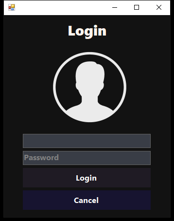 | **Wrong password** <br> 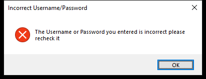 |
| **Admin portal** <br> 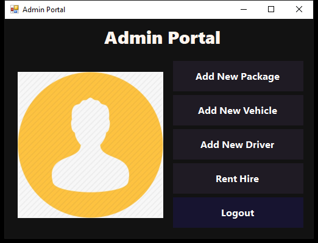 | **User portal** <br> 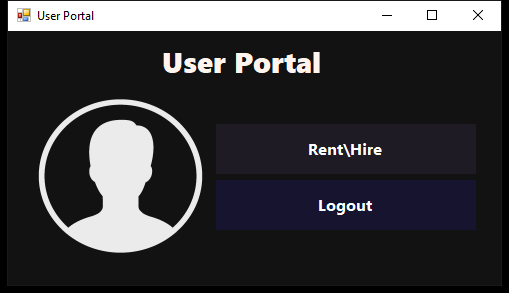 |
| **Add new vehicle** (after searching ID 1) <br> 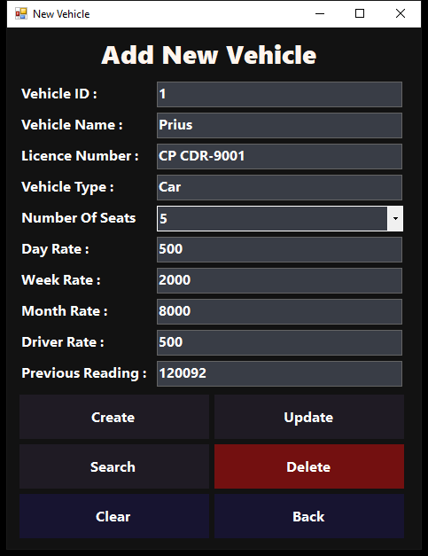 | **Add new driver** (after searching ID 1) <br> 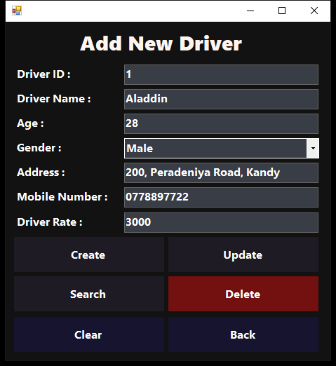 |
| **Add new package** (after searching ID 1) <br> 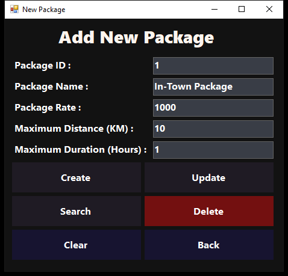 | **Hiring menu** <br> 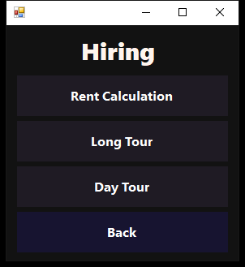 |

**Day tour** costing:

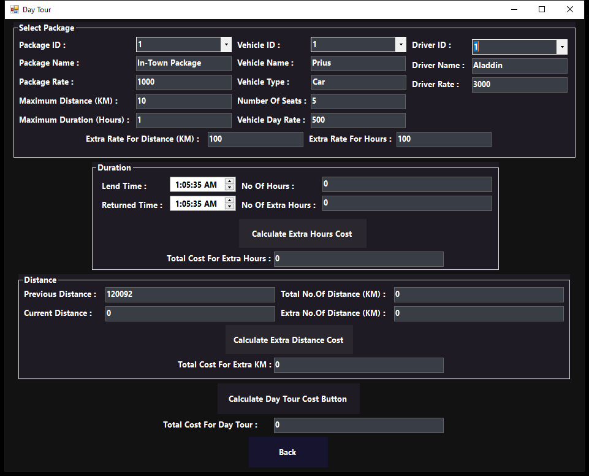

**Long tour** costing:

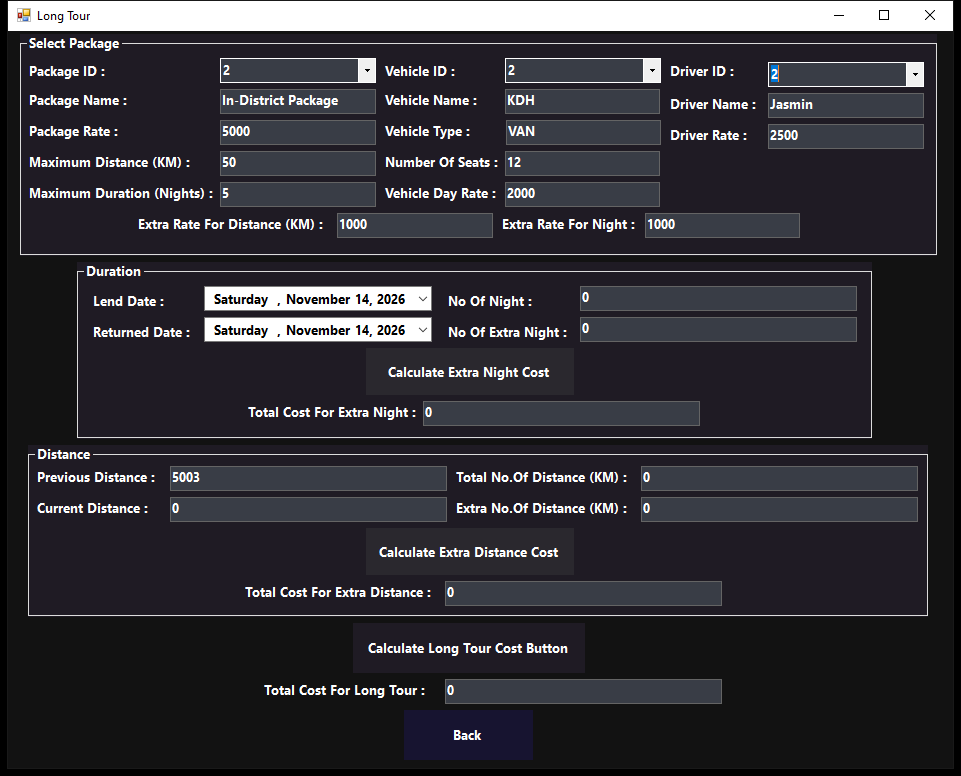

**Rent calculation** (by the day, week or month):

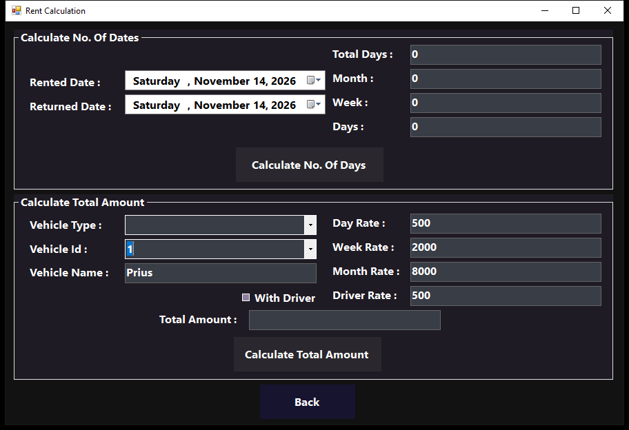

## Logins

The usernames and passwords are hardcoded in `AyoboDrive/LoginForm.cs`. There is no sign-up screen.

| Role | Username | Password | What it opens |
| --- | --- | --- | --- |
| Admin | `admin` | `admin123` | Admin Portal: manage packages, vehicles, drivers, and hiring |
| User | `user` | `user123` | User Portal: hiring only |

The usernames are accepted as `admin`/`Admin`/`ADMIN` and `user`/`User`/`USER`. The
passwords are case-sensitive. Anything else shows the error in the second screenshot.

## Features

**Admin portal**

- **Add New Vehicle**: create, search, update, delete and clear vehicle records (ID, name, type,
  licence number, seats, day/week/month rates, driver rate, previous odometer reading).
- **Add New Driver**: the same operations for drivers (name, age, gender, address, mobile
  number, driver rate).
- **Add New Package**: the same operations for tour packages (name, rate, maximum distance,
  maximum duration).
- **Rent Hire**: opens the hiring menu (below).

**Hiring menu** (available to both admin and user)

- **Rent Calculation**: price a plain vehicle rental by date range.
- **Day Tour**: price a one-day tour package.
- **Long Tour**: price a multi-day tour package.

### How the costs are calculated

This is what the code does, so the numbers on screen can be checked by hand.

**Rent Calculation**

1. The number of days between the rented date and the returned date is split into whole
   months (30 days), then whole weeks (7 days), then remaining days.
2. Total = (day rate x days) + (week rate x weeks) + (month rate x months).
3. If **With Driver** is ticked, driver rate x total days is added.

**Day Tour**

- Extra hours = hours between lend and return time, minus the package's maximum duration (if positive),
  times the extra-hour rate.
- Extra distance = (current reading minus previous reading) minus the package's maximum distance (if
  positive), times the extra-km rate.
- Day tour total = vehicle day rate + driver rate + extra-hours cost + extra-distance cost.

**Long Tour**

- Nights = days between lend and return dates, minus 1. Extra nights beyond the package's
  maximum are charged at the extra-night rate.
- Extra distance is worked out the same way as for a day tour.
- Long tour total = vehicle day rate + driver rate + extra-nights cost + extra-distance cost.

## Tech stack

- C# on .NET Framework 4.7, Windows Forms
- SQL Server LocalDB, accessed with `System.Data.SqlClient` and parameterised queries
- No NuGet packages

## Getting started

### Requirements

- Windows
- Visual Studio 2019 or newer (with the ".NET desktop development" workload), or JetBrains Rider
- SQL Server LocalDB (installed with Visual Studio)

### Set up the database

The app talks to a database called `AyuboDrive` (the spelling in the database files differs
slightly from the project name). There are two ways to get one.

**Option 1: run the SQL script (recommended).** This works with any LocalDB or SQL Server version.

1. Create the database and sample data:

   ```
   sqlcmd -S "(localdb)\MSSQLLocalDB" -E -i database\AyuboDrive.sql
   ```

2. Open `AyoboDrive/App.config` and replace the connection string with one that uses the database
   name:

   ```xml
   <add name="AyoboDb"
        connectionString="Data Source=(LocalDB)\MSSQLLocalDB;Initial Catalog=AyuboDrive;Integrated Security=True;Connect Timeout=30"
        providerName="System.Data.SqlClient"/>
   ```

**Option 2: use the bundled database file.** `App.config` already points at `AyuboDrive.mdf`,
which Visual Studio copies next to the built program. This only works if your LocalDB is
**SQL Server 2022**. On an older version the app fails to open the file with an error
saying the database is "version 957" and the server supports an earlier one. In that case use
Option 1.

`database/AyuboDrive.bak` is a full SQL Server backup of the database (taken 2022-09-20) if you
prefer to restore it yourself with SSMS or `RESTORE DATABASE`.

### Build and run

1. Open `AyoboDrive.sln`.
2. Press **F5**, or build from the command line:

   ```
   msbuild AyoboDrive.sln /p:Configuration=Debug
   ```

3. Log in with one of the accounts above.

## Database

Three tables, no foreign keys:

| Table | Columns |
| --- | --- |
| `newDriver` | `driverId`, `driverName`, `age`, `gender`, `address`, `mobileNumber`, `driverRate` |
| `newVehicle` | `vehicleId`, `vehicleName`, `vehicleType`, `licenceNumber`, `numberOfSeats`, `dayRate`, `weekRate`, `monthRate`, `driverRate`, `previousReading` |
| `newPackage` | `packageId`, `packageName`, `packageRate`, `maximumDistance`, `maximumDuration` |

The sample data is 2 drivers, 2 vehicles (a Prius and a KDH van) and 3 packages (In-Town,
In-District, Airport Drop).

## Project structure

```
AyoboDrive.sln
AyoboDrive/
  Program.cs                 Entry point, opens LoginForm
  LoginForm.cs               Hardcoded admin/user login
  AdminForm.cs, UserForm.cs  Portals after login
  NewVehicle.cs              Vehicle records
  NewDriver.cs               Driver records
  NewPackage.cs              Package records
  VehicleRentForm.cs         Hiring menu
  RentCalculationForm.cs     Rental price by date range
  DayTourForm.cs             Day tour pricing
  LongTourForm.cs            Long tour pricing
  App.config                 Database connection string
  AyuboDrive.mdf / .ldf      LocalDB database files (SQL Server 2022 format)
  Resources/                 Images used by the forms
database/
  AyuboDrive.sql             Tables and sample data as a script
  AyuboDrive.bak             Full backup of the database
screenshots/                 Images used in this README
```

## Changes from the original

The first commit in this repo is the project exactly as it was submitted. The second commit
fixes two problems found while running the app for the screenshots, both on the Add New Vehicle screen:

- The **Search** button was never connected to its handler, so clicking it did nothing.
- The screen's Create, Update and Search code was written for a vehicle table without the
  `vehicleType` column. The database (and the tour and rent screens) use the version with it,
  so Create would fail and Search would show values in the wrong boxes. It now reads and writes
  `vehicleType` and reads by column name.
- The pop-up messages on this screen were copied from other screens ("New Driver Created",
  "Package Updated", "Package Not Found") and now say "Vehicle".

## Known issues

These are left as they were written:

- **Hardcoded logins.** Credentials are compared as plain text in `LoginForm.cs`. Fine for a
  class demo, not for real use.
- **Tour totals leave out the package rate.** The day-tour and long-tour totals add the vehicle
  day rate, driver rate and extra charges. The selected package's own rate is shown on screen
  but is not part of the total.
- **Vehicle Type box on Rent Calculation clears itself.** Choosing a type filters the Vehicle ID
  list as intended, but the type box then goes blank because the code clears and refills its items.
- **Driver search message.** Searching for a driver ID that does not exist shows "Package Not
  Found".
